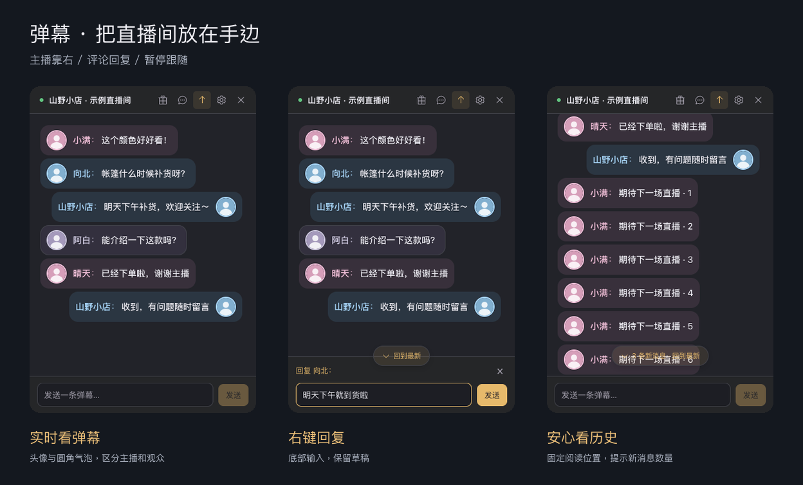
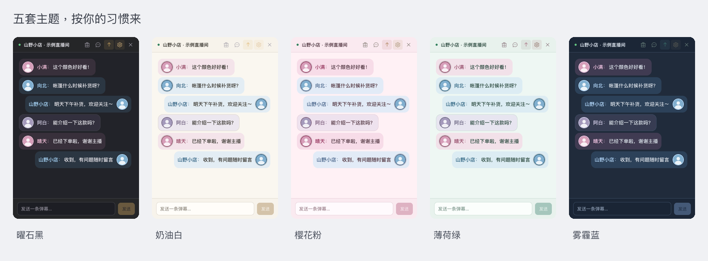
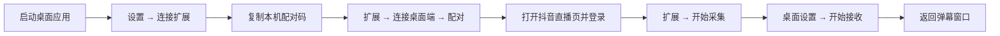
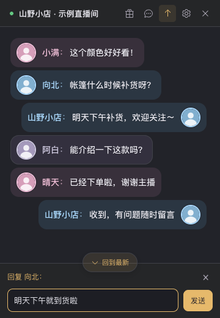
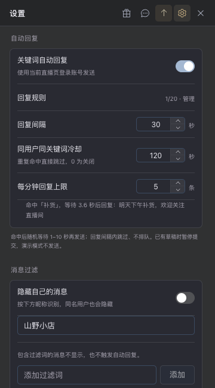
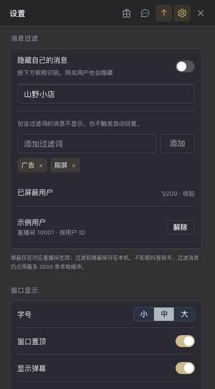
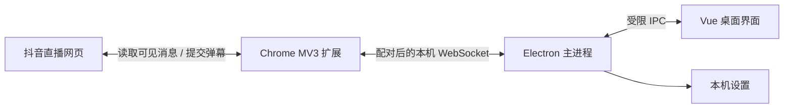

<div align="center">

# douYinChat · 抖音直播弹幕助手

一个可以置顶、换肤、回复评论的轻量桌面弹幕窗口。

把直播间的新消息放在手边，让查看弹幕、回复观众和维护聊天秩序更方便。


[功能亮点](#功能亮点) · [快速开始](#快速开始) · [使用教程](#使用教程) · [常见问题](#常见问题) · [数据与安全](#数据与安全) · [免责声明](#免责声明) · [开发说明](#开发说明)



_截图来自当前软件界面，使用示例昵称、头像和弹幕内容。_

</div>

## 功能亮点

| 功能           | 可以做什么                                                                   |
| -------------- | ---------------------------------------------------------------------------- |
| 桌面弹幕窗口   | 接收当前抖音直播页的新弹幕；默认 360 × 520，支持调整大小、置顶和关闭到托盘   |
| 主播消息靠右   | 根据网页的官方主播徽章识别，主播消息与头像靠右，观众消息靠左                 |
| 圆角聊天气泡   | 头像、昵称、内容一体展示；有公开性别标识时区分蓝色与粉色，未知时使用中性配色 |
| 手动发送与回复 | 底部输入栏发送弹幕；右键评论选择回复，取消回复时保留草稿                     |
| 关键词自动回复 | 关键词对应固定回复，支持规则开关、删除和不实际发送的匹配测试                 |
| 自动回复防刷屏 | 随机等待、全局间隔、同用户同关键词冷却与滚动一分钟上限共同生效               |
| 暂停滚动看历史 | 上滑或右键时暂停跟随；后台继续接收，显示新消息数量，点击回到最新             |
| 用户屏蔽与过滤 | 按直播间屏蔽用户、管理过滤词，或按填写的昵称隐藏自己的消息                   |
| 资料读取优化   | 可靠用户 ID 对应的头像、性别资料复用缓存；连续失败时暂停请求，避免反复查询   |
| 五套主题       | 曜石黑、奶油白、樱花粉、薄荷绿、雾霾蓝，切换立即生效并自动保存               |

### 换一套喜欢的颜色

主题会同步改变聊天区、输入栏、设置和二维码窗口，保留男女气泡的区分。



> 当前为 DOM 适配开发版，真实弹幕采集和回复已完成首轮验证。真实礼物采集尚未实现，演示中的礼物仅用于预览样式；当前以一个选中的直播页为采集来源。

## 快速开始

### 1. 启动桌面应用

推荐环境：**Node.js 22+、pnpm 8+、Chrome / Chromium 120+**。当前主要在 macOS 验证，其他系统仍需实机测试。

克隆本仓库，进入包含 `package.json` 的项目目录后运行：

```bash
pnpm install
pnpm dev
```

如需运行构建版本：

```bash
pnpm build
pnpm start
```

桌面窗口出现后，保持应用运行。第一次使用需要连接浏览器扩展。

### 2. 加载浏览器扩展

1. 在 Chrome 地址栏打开 `chrome://extensions`。
2. 开启右上角的 **开发者模式**。
3. 点击 **加载已解压的扩展程序**，选择本仓库中的 [`extension`](extension) 文件夹。
4. 建议把「弹幕 · 抖音直播助手」固定在浏览器工具栏，方便后续选择直播间。

当前扩展版本：**0.3.4**。桌面安装包不会自动安装这个扩展，需要单独加载。

### 3. 配对并开始接收



1. 点击桌面顶部的 **齿轮图标**，进入 **连接 → 连接扩展**，复制配对码。
2. 点击浏览器扩展，在 **连接桌面端** 中粘贴配对码并点击 **配对**。
3. 确认扩展显示 **桌面端已连接**。
4. 打开一个正在直播的 `https://live.douyin.com/直播间号` 页面，并保持有效登录状态。
5. 在该直播标签页打开扩展，点击 **开始采集**。
6. 回到桌面 **设置 → 连接**，点击 **开始接收**，再点齿轮返回弹幕。

新的网页弹幕会出现在桌面窗口中。扩展弹窗可以关闭，采集使用的直播标签页需要保持打开。

本机连接地址为 `127.0.0.1:17869`，配对码保存在本机；不要把自己的配对码提交到仓库或贴在公开截图中。

## 使用教程

### 发送普通弹幕与回复评论

<table>
<tr>
<td width="50%" align="center"></td>
<td width="50%">

**普通消息**

在底部输入内容，点击「发送」或按 Enter。

**回复某位观众**

右键弹幕 →「回复评论」→ 底部输入内容 → 发送。

**切回普通消息**

点击「回复 昵称：」右侧的 ×。输入的文字会保留。

</td>
</tr>
</table>

回复会以普通公开弹幕发送。例如回复「向北」，输入「明天下午到货」，实际提交的文本为：

```text
向北,明天下午到货
```

这不是抖音原生的 @ 提醒或私信。普通消息最多 100 字符，回复中的昵称、逗号和内容合计最多 100 字符。

提交成功后清空输入栏；失败保留草稿，结果未知时不自动重试。输入框清空表示已提交给直播页面，不等同于平台确认送达。直播网页已有手动草稿时，应用会暂停提交，不覆盖网页草稿。

### 配置关键词自动回复

<table>
<tr>
<td width="50%" align="center"></td>
<td width="50%">

1. 进入 **设置 → 自动回复 → 回复规则**。
2. 填写关键词与对应回复，点击 **添加规则**。
3. 使用 **匹配测试** 检查规则，不会实际发送。
4. 开启 **关键词自动回复**。

例：关键词 `补货`，回复 `明天下午补货，欢迎关注直播间`。

</td>
</tr>
</table>

匹配不区分大小写，包含关键词即命中；按列表顺序只执行第一条启用的规则，最多保存 20 条。自动回复默认关闭，开启后使用当前直播页登录的抖音账号发送。

| 防刷屏设置         | 默认值  | 行为                                                   |
| ------------------ | ------- | ------------------------------------------------------ |
| 随机等待           | 1–10 秒 | 每次命中后随机等待再提交                               |
| 全局回复间隔       | 30 秒   | 间隔内的新命中跳过，不排队、不补发；可设置 5–3600 秒   |
| 同用户同关键词冷却 | 120 秒  | 重复命中跳过；可设置 0–3600 秒，0 表示关闭此项         |
| 每分钟回复上限     | 5 条    | 按滚动 60 秒计算，结果未知的尝试也计数；可设置 1–30 条 |

等待期间关闭自动回复、修改规则或过滤限制、停止接收、切换直播间，会取消待回复。被屏蔽或过滤的消息不会触发自动回复。上述频率限制针对自动回复，手动发送仍可使用。

### 暂停滚动，慢慢看历史

向上滚动时暂停跟随；右键操作弹幕也会暂停，避免正在选择的消息移动。

新消息继续在后台接收，按钮显示「N 条新消息 · 回到最新」。点击按钮恢复跟随，滚动到底部也可恢复（正在操作回复时除外）。消息缓冲最多 2000 条；后台淘汰旧数据时，当前阅读快照保持稳定。

历史查看效果见顶部总览右图。

### 屏蔽用户、过滤消息

<table>
<tr>
<td width="50%" align="center"></td>
<td width="50%">

**屏蔽用户**：右键弹幕 →「屏蔽此用户」。

**解除屏蔽**：设置 → 消息过滤 → 已屏蔽用户 →「解除」。

**过滤词**：添加不想看到的词，包含该词的消息不显示，匹配不区分大小写。

**隐藏自己**：填写当前登录账号的准确昵称，再开启「隐藏自己的消息」。

</td>
</tr>
</table>

屏蔽仅在对应直播间生效。有可靠用户 ID 时按 ID 屏蔽；没有 ID 时按昵称匹配，同名用户也会受影响。隐藏自己的消息同样按填写的昵称匹配。

最多保存 200 个屏蔽用户、50 个过滤词。设置保存在本机；过滤和屏蔽不改变抖音账号的黑名单，被隐藏消息仍占用本地消息缓冲。

### 主题、置顶与顶部图标

| 入口            | 操作                                         |
| --------------- | -------------------------------------------- |
| 上箭头          | 开启或取消窗口置顶，开启时高亮               |
| 齿轮            | 打开或关闭设置，打开时高亮，始终保留齿轮图标 |
| 设置 → 主题换肤 | 选择五套主题之一，立即生效，重启后恢复       |
| 设置 → 窗口显示 | 调整字号、显示弹幕、窗口置顶与关闭到托盘     |
| 礼物图标        | 显示打赏二维码                               |
| 对话气泡图标    | 显示投诉建议的联系二维码                     |

二维码窗口可点击 ×、点击遮罩或按 Esc 关闭。默认关闭桌面窗口会退出；开启「关闭到托盘」后，关闭窗口可继续在后台采集与自动回复，退出请使用托盘菜单。

## 常见问题

<details>
<summary><strong>连接成功了，为什么没有历史弹幕？</strong></summary>

应用主要接收开始采集后的新消息，不回填直播页已有历史。确认直播正在进行、页面能看到新弹幕，并且扩展已选择该直播间、桌面已开始接收。

</details>

<details>
<summary><strong>为什么没有头像或性别颜色？</strong></summary>

头像与性别依赖网页可读取的公开资料。资料缺失、登录失效、读取失败时，显示昵称首字和中性气泡，不影响消息展示。性别只读取明确的官方图标，不根据昵称或头像推断。无官方主播标识的消息也不会仅凭昵称靠右显示。

同来源下，有可靠 ID 的用户会复用资料缓存：完整资料 10 分钟，不完整资料 1 分钟，最多 500 项。连续失败 3 次会暂停该来源资料请求 30 秒，后续新消息到达时重试；同名无 ID 用户不混用资料。

</details>

<details>
<summary><strong>自动回复开启了却没有发出去？</strong></summary>

检查规则是否启用、当前消息是否命中，以及回复间隔、用户冷却、每分钟上限是否生效。还需保证直播网页已登录且可以正常发言、页面没有未发送草稿、桌面正在接收。设置中的状态文字会显示等待、跳过或提交结果。

</details>

<details>
<summary><strong>更新后提示扩展或直播页脚本版本过旧？</strong></summary>

先在 `chrome://extensions` 重新加载本扩展，再刷新直播标签页，重新选择「开始采集」，最后在桌面点击「开始接收」。桌面代码更新后也需要重启应用。

</details>

<details>
<summary><strong>能同时采集多个直播间，或者自动补齐断线消息吗？</strong></summary>

当前扩展以一个选中的直播标签页为来源。多直播间并行采集、可靠的下播识别和断线历史补传尚未完成。采集依赖网页实际呈现的内容，不保证完整消息流。

</details>

<details>
<summary><strong>有正式安装包和自动更新吗？</strong></summary>

仓库提供 Windows x64 安装包构建和 GitHub Actions 自动打包流程，可手动运行或通过版本标签生成草稿发布。当前仍为开发预览版，未配置 Windows 代码签名，也未完成 Windows 实机验收；客户端自动更新尚未接入。操作见 [Windows 打包与发布](docs/WINDOWS.md)。

</details>

## 数据与安全

### 数据经过哪里？

弹幕在 **抖音网页 → 浏览器扩展 → 本机桌面应用** 之间流转。当前代码未接入项目自建云端、统计埋点或聊天记录上传服务，也不提供云端同步。发送弹幕仍通过已登录的抖音网页提交给抖音。

**本地处理不等于完全离线**：直播网页、用户资料读取和头像加载仍会访问抖音及其图片 CDN，受平台和浏览器自身的数据处理规则影响。

| 数据                                             | 用途                                                            | 保存位置与期限                                                                                             |
| ------------------------------------------------ | --------------------------------------------------------------- | ---------------------------------------------------------------------------------------------------------- |
| 弹幕内容、昵称、可用的用户 ID、房间与主播标识    | 展示、回复定位、去重、过滤与防刷屏                              | 主进程和界面中的有限内存缓冲，不提供聊天历史数据库或自动导出                                               |
| 公开用户资料                                     | 补全头像和性别；网页资料响应还可能包含年龄、地区、关注/粉丝统计 | 资料对象在内存缓存，最多 500 项；完整资料 10 分钟、不完整资料 1 分钟，清空消息或切换房间时清除界面资料缓存 |
| 主题、回复规则、过滤词、屏蔽名单、填写的本人昵称 | 恢复个人设置                                                    | Electron 应用数据目录中的 `settings.json`，保留到修改或删除                                                |
| 本机配对码                                       | 验证扩展与桌面连接                                              | 应用数据目录中的 `pairing-token`，以及扩展的 `chrome.storage.local`                                        |
| 当前采集标签页和房间                             | 把消息与命令发送到选定的页面                                    | 扩展的会话存储；停止采集、关闭标签页时清理相应选择                                                         |

头像请求等网络资源可能产生 Chromium 自身的磁盘缓存；“内存缓冲”不表示操作系统、浏览器或抖音网页完全不会留下其他缓存。

### 已实现的保护

- **仅监听本机**：桌面 WebSocket 绑定 `127.0.0.1:17869`，不绑定局域网或公网地址。
- **配对后通信**：使用加密安全随机源生成 24 字节配对码，以 48 位十六进制显示；连接检查扩展来源格式，并校验配对码。它不是抖音账号密码。
- **按来源限制操作**：消息校验房间与来源；回复和资料查询绑定已选中的页面，命令有过期时间，连接或接收状态改变会取消待处理操作。
- **桌面页面隔离**：启用 Electron 沙箱、上下文隔离，关闭渲染页面的 Node.js 集成；只暴露限定用途的桌面 API，阻止任意页面跳转和新窗口。
- **限制资料字段**：校验消息格式、设置范围及资料长度；头像地址只接受 HTTPS 的抖音图片 CDN 子域。界面使用文本渲染消息，不把弹幕当 HTML 执行。
- **无需导出登录凭据**：扩展未申请 Cookie 读取权限，代码不主动提取抖音密码或 Cookie；采集与发送依赖浏览器中已有的登录状态。

### 需要知道的边界

本地设置与配对码**没有额外加密**，本机 WebSocket 使用 `ws://`，不宣称端到端加密。程序创建设置文件与配对码文件时请求 `0600` 权限，实际保护效果取决于操作系统；扩展本地存储也不能视作密码保险箱。拥有本机账户或足够系统权限的程序仍可能读取相关数据。

开启自动回复意味着授权当前直播页登录账号按规则发出**公开消息**；默认关闭，开启后可随时停止。关闭到托盘时程序仍可能继续接收与回复，需要完全停止时请关闭自动回复、停止接收，或从托盘退出应用。

项目目前未经独立安全审计。自动回复防刷屏用于控制发送频率，不代表抖音平台允许所有自动化行为，也不能保证不会触发平台限制。

### 停止与清理

- 暂停采集：在桌面点击 **停止接收**，或在扩展中点击 **停止采集**。
- 清空显示和界面资料缓存：**设置 → 其他 → 清空当前消息**。主进程最近事件缓存随进程退出释放。
- 清理持久化设置：完全退出应用后，按需移除应用数据目录中的 `settings.json`；移除 `pairing-token` 后，下次启动会重新生成配对码，需要重新配对。
- 清理扩展侧数据：清除或移除扩展的本地数据；仅卸载桌面应用不代表浏览器扩展数据会自动删除。

反馈问题时不要公开配对码、Cookie、登录凭据或完整的应用数据目录。正常运行不需要开启远程调试端口；开发排查时开启的调试接口不属于面向日常使用的访问控制。

## 免责声明

- **本项目仅供学习和研究使用，请勿用于商业用途。**
- 本项目为第三方开发的非官方工具，与抖音、字节跳动及其关联公司无隶属关系，不代表任何平台的官方立场或背书。
- 使用前请了解并遵守适用法律法规、抖音用户协议、直播互动规则及相关服务条款。请勿用于批量营销、刷屏骚扰、欺诈、侵犯隐私、未经授权采集或其他违规场景。
- 请仅在你有权访问和操作的直播页面及账号中使用。公开可见的信息不等于可以任意保存、传播或用于其他目的。
- 自动回复和手动回复均通过当前登录账号向直播间发送公开消息，请自行核对账号、回复内容与规则，并承担相应的账号操作责任。防刷屏设置不代表平台认可自动化操作，也不能消除账号受限的风险。
- 软件按“现状”提供，不保证采集完整性、持续可用性、消息送达或与未来平台版本的兼容性。平台页面、规则或登录状态变化可能导致功能失效。
- **使用者应自行评估并承担使用风险。** 在适用法律允许的范围内，开发者不对使用或无法使用本软件引起的账号限制、数据损失、业务中断或其他损失承担责任。
- 如果平台规则不允许相关操作，请停止使用对应功能；如存在侵权或其他问题，欢迎通过仓库 Issues 联系处理。

## 开发说明

### 技术结构



- **桌面**：Electron 44、Vue 3、TypeScript、Element Plus。
- **构建**：electron-vite / Vite、electron-builder。
- **采集**：浏览器扩展读取可见 DOM，与本机应用配对通信；无需在桌面填写抖音 Cookie。
- **本地数据**：弹幕使用内存缓冲，设置和配对信息保存在本机；不提供项目服务端或云同步。

### 常用命令

```bash
pnpm dev           # 桌面开发模式
pnpm build         # 类型检查并构建
pnpm start         # 启动已构建桌面应用
pnpm preview:web   # 浏览器界面预览，不具备真实桌面发送能力
pnpm test          # 单元与桥接测试
pnpm typecheck     # TypeScript / Vue 类型检查
pnpm lint          # 代码规范检查
```

浏览器预览默认地址为 `http://127.0.0.1:5173`，以终端实际输出为准：

- `/?preview=messages`：带明确演示标记的消息与礼物样式预览。
- `/?preview=settings`：设置预览。
- 无参数：等待连接界面，不自动填充演示数据。

### Windows 打包与自动发布

```sh
pnpm release:win    # 构建 Windows x64 安装包、浏览器扩展 ZIP 和校验清单
pnpm build:win      # 仅构建 Windows x64 安装包
pnpm release:assets # 为已有安装包整理分发文件
```

可分发文件位于 `dist/release/`，扩展需要用户单独解压并加载。安装向导支持选择目录与桌面快捷方式。已接入 Q 版直播主题图标及安装向导配图，未配置 Windows 代码签名。

GitHub Actions 支持手动构建、拉取请求检查，以及 `v*` 标签触发的草稿发布；不需要个人访问令牌，不包含客户端自动更新。仅考虑 Windows x64，暂不维护 macOS / Linux 打包流程。详细步骤、素材规格和 Windows 验收清单见 [Windows 打包与发布](docs/WINDOWS.md)。

### 目录结构

```text
├── extension/                  # Chrome MV3 扩展
├── src/main/                   # Electron 窗口、配对桥接、设置、自动回复
├── src/preload/                # 受限桌面 API
├── src/renderer/src/
│   ├── components/             # 弹幕、输入栏、主题与各设置界面
│   ├── composables/            # 应用状态与资料读取队列
│   ├── core/                   # 消息管线与资料缓存
│   └── assets/                 # 样式、主题与二维码资源
├── src/shared/                 # 事件类型、设置校验、过滤规则
├── tests/                      # 单元与桥接测试
├── docs/images/                # README 配图
└── DEVELOPMENT.md              # 开发记录与验收说明
```

更多实现细节见 [DEVELOPMENT.md](DEVELOPMENT.md)。当前 27 项测试覆盖消息去重、房间隔离、配对通信、自动回复及防刷屏、过滤、资料缓存、主播标识和设置迁移；界面操作另通过浏览器夹具验证。

## 反馈与支持

遇到问题或有新想法，欢迎通过仓库 Issues 反馈。建议附上操作步骤、系统与浏览器版本、桌面和扩展版本，以及去除配对码等信息后的截图。

也可以在软件顶部点击 **对话气泡图标** 扫码反馈；如果这个小工具帮到了你，欢迎通过 **礼物图标** 随心打赏。
